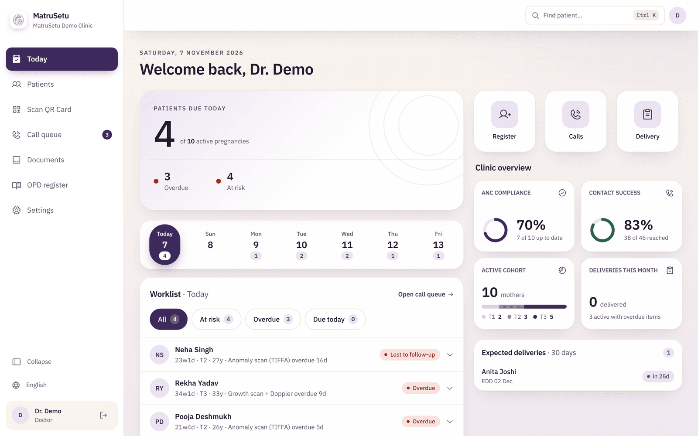
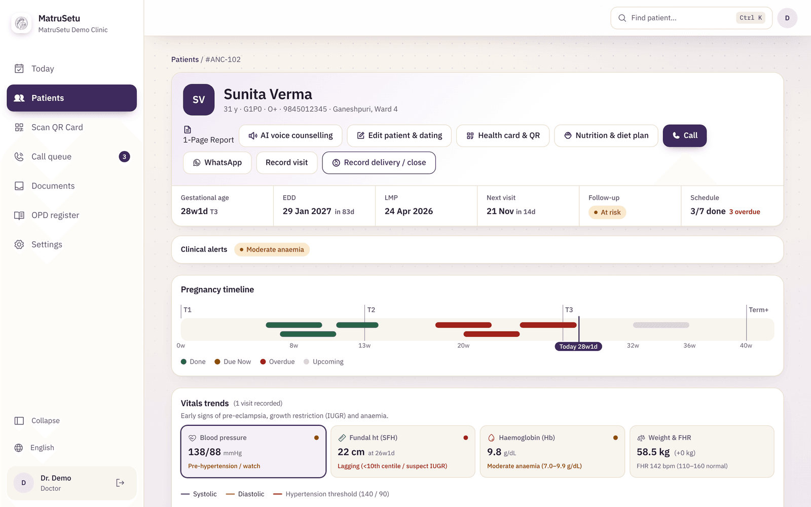
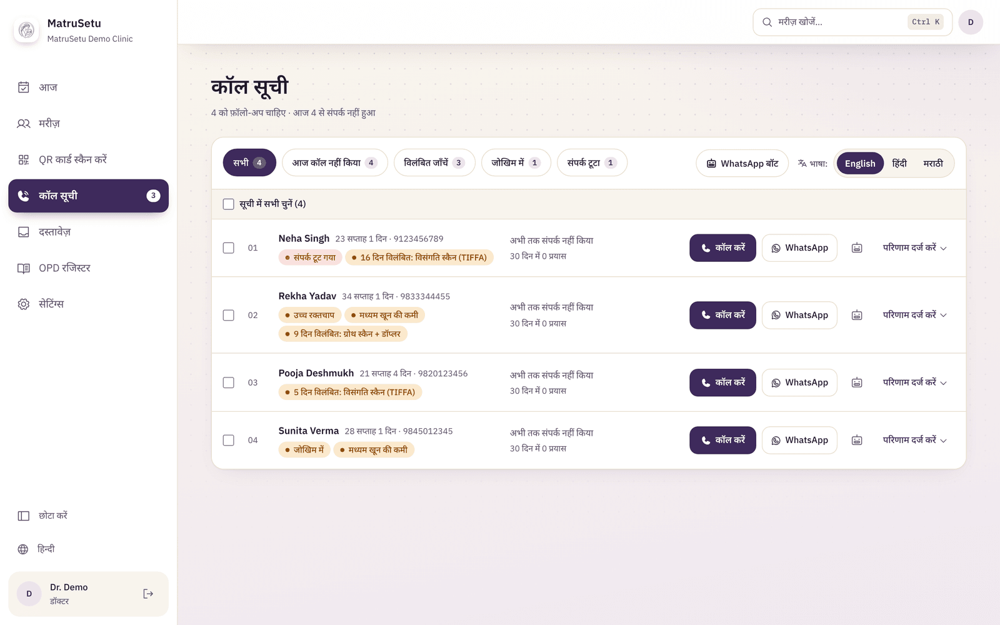
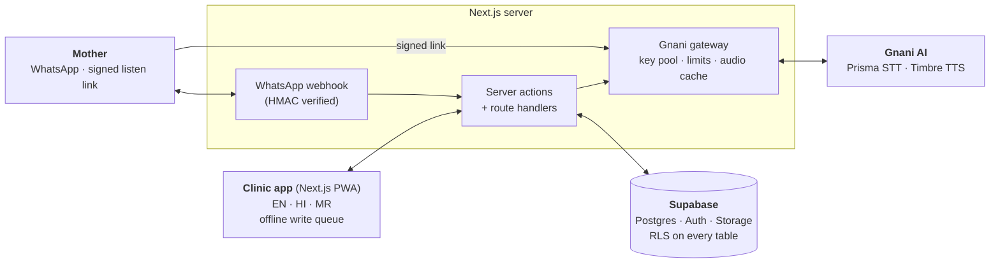

<div align="center">


# MatruSetu

### Antenatal care, organised. Every pregnancy tracked. Every follow-up caught.

Assistive pregnancy tracking and OPD digitisation for OB-GYN clinics in India,
in **English · हिन्दी · मराठी**, with optional **Gnani AI** voice.

[](https://matruseva.vercel.app)
[](https://youtube.com/watch?v=5jRca_mqR90)


</div>

---

## 🔗 Try it now

| | |
|---|---|
| **Live app** | **<https://matruseva.vercel.app>** |
| **Demo login** | Email `demo.doctor@matrusetu.test` · Password `DemoClinic123!` (pre-filled on the sign-in page, just press **Sign in**) |
| **Video** | [Watch on YouTube](https://youtube.com/watch?v=5jRca_mqR90) |

The demo clinic is fabricated: 10 synthetic patients across trimesters and follow-up states. Nothing you do there touches real data.

## ▶️ See it in 50 seconds

[](https://youtube.com/watch?v=5jRca_mqR90)

<sub>Click the preview to watch the full video on YouTube.</sub>

## 📸 Screenshots

<table>
  <tr>
    <td width="50%"><br /><sub><b>Today</b>: who is due, who is overdue, what to do next.</sub></td>
    <td width="50%"><br /><sub><b>Patient record</b>: auto-built ANC timeline, clinical alerts, vitals trends.</sub></td>
  </tr>
  <tr>
    <td colspan="2"><br /><sub><b>Call queue in हिन्दी</b>: the whole app switches between English, Hindi and Marathi.</sub></td>
  </tr>
</table>

---

## Why MatruSetu

A private OB-GYN practice may follow **hundreds of pregnancies on paper registers**. One missed anomaly scan or a skipped follow-up can mean a missed complication, and nobody notices until it is too late.

MatruSetu gives the doctor and care team one place that:

- **Builds the full ANC schedule from the LMP**: scans, tests and injections, week by week.
- **Flags mothers who are drifting out of follow-up**, scored from overdue items and missed contacts.
- **Turns the follow-up into one tap**: call, or WhatsApp a reminder in the mother's language.
- **Digitises paper**: photographed case papers, PDFs and lab reports become one searchable patient timeline.
- **Speaks the clinic's languages**: dictate vitals in Hindi, Marathi or Hinglish, and give mothers spoken counselling in their own language.
- **Keeps working when the network doesn't**: visits and call logs queue offline and sync later.

> Built for the **Health-a-thon 2026** (Koita Foundation / IIT Bombay), Maternal & Child Health track, *"Patient Follow-up & Continuity of Care."*

## ✨ Features

### For the doctor and care team
| | |
|---|---|
| **Today command centre** | Patients due, overdue and at risk, a 7-day strip, worklist, upcoming deliveries and a clinic analytics summary |
| **Auto ANC schedule** | Enter the LMP once; the FOGSI/MoHFW-based schedule, GA and EDD build themselves. LMP corrections regenerate it |
| **Follow-up risk** | On track / at risk / lost, from overdue items and contact history, with clinical alert filters |
| **Call queue** | One-tap call and WhatsApp, per-clinic message templates, contact logging, batch logging |
| **Visit recording** | Vitals with clinical flags (BP, Hb, FHR, fundal height) and trend charts |
| **Pregnancy questionnaire** | Seven obstetric-history questions that feed the one-page report. Questions that don't apply are hidden and the rest **renumber automatically** |
| **One-page patient report** | Obstetric history, vitals, scans, ANC milestones and risk alerts on one printable page |
| **Documents and OCR** | Photograph or upload case papers and PDFs; in-browser OCR and full-text search |
| **OPD register, delivery outcome, QR health pass, nutrition plans** | Registration, closure with delivery details, a printable QR card and a reception scanner |
| **Doctor settings** | Clinic details, risk thresholds, schedule template, staff invites, message templates, clinical protocol sign-off |

### Voice AI, powered by Gnani (optional)
| | |
|---|---|
| **Voice-to-vitals (Prisma STT)** | Dictate "BP 130 by 80, weight 54, hemoglobin 9.5" in Hindi, Marathi, English or Hinglish. A Devanagari-aware parser fills the visit form and the clinician confirms before anything is saved |
| **Spoken counselling (Timbre TTS)** | Counselling for the mother in Hindi, Marathi, Gujarati or English, played from a signed link on her phone |
| **WhatsApp voice notes** | Mothers can answer by voice; the bot transcribes it and handles confirm / reschedule / info, with a broad **danger-sign screen** that replies urgently (nearest hospital / 108) and flags staff |
| **Always a fallback** | No key, no credit or no network? Every feature falls back to the browser's speech APIs |

Architecture, limits and a real-key check: [`docs/GNANI_INTEGRATION.md`](docs/GNANI_INTEGRATION.md) and [`docs/GNANI_SETUP.md`](docs/GNANI_SETUP.md).

### Reliability, access and trust
- **English, हिन्दी, मराठी** across the whole staff UI (typed catalogues with key-parity tests, a Devanagari font and a glossary of obstetric terms).
- **Installable PWA** with an offline fallback page and an **offline write queue** (IndexedDB, idempotent replay, retry or discard for failures).
- **Row-level security** on every table, signed expiring links for mothers, a verified WhatsApp webhook, and every feature fails closed when its config is missing. See [`docs/SECURITY.md`](docs/SECURITY.md).
- **Fast**: deferred and paged lists, lazy-loaded modals, cached audio, and a collapsible desktop sidebar.

## 🧭 How it fits together



## 🧰 Tech stack

Next.js 16 (App Router) · React 19 · TypeScript · Tailwind CSS v4 · Supabase (Postgres, Auth, Storage, RLS) · Serwist (PWA) · Tesseract.js + pdfjs-dist (in-browser OCR) · Zod and React Hook Form · Gnani AI (Prisma, Timbre) · Vitest + Playwright.

## ✅ Quality

- **590 unit tests** in 33 files (Vitest) covering clinical logic, scheduling, risk, i18n key parity, the offline queue, the WhatsApp bot, the Gnani client and the questionnaire. Run `npm test`.
- CI runs lint, typecheck, unit tests, SQL validation, `npm audit --omit=dev --audit-level=high` (currently **0 vulnerabilities**) and a production build.
- One Playwright golden-path spec (needs live Supabase, so it is not run in CI).
- Designed for accessibility: AA colour contrast, 44 px touch targets, keyboard and screen-reader support.

## 🚀 Run it locally in 2 minutes

You do **not** need Supabase or any API key to explore the app. Demo mode serves the fabricated clinic.

```bash
git clone https://github.com/madhavzanwar/Matruseva.git
cd Matruseva
npm install
cp .env.example .env.local     # on Windows PowerShell: Copy-Item .env.example .env.local
```

Open `.env.local` and **uncomment the `DEMO_MODE=1` line**, then:

```bash
npm run dev
```

Open <http://localhost:3000> and sign in (the demo credentials are pre-filled).

**Run it for real** (your own Supabase project): fill the Supabase values in `.env.local`, leave `DEMO_MODE` unset, and apply the migrations. In the Supabase dashboard open **SQL Editor** and paste [`supabase/apply-pending.sql`](supabase/apply-pending.sql), or use the CLI (`npx supabase link` then `npx supabase db push`). `npm run db:seed` creates the demo clinic in your database.

### Commands

| Command | What it does |
|---|---|
| `npm run dev` / `npm start` | Dev server / serve the production build |
| `npm run build` | Production build (`next build --webpack`; Serwist's service worker needs webpack) |
| `npm run lint` · `npm run typecheck` | ESLint · `next typegen` then `tsc --noEmit` |
| `npm test` | Unit tests (590 tests, 33 files) |
| `npm run db:validate` | Offline SQL syntax check for the migrations |
| `npm run gnani:check` | Real-key smoke test: Timbre → Prisma round trip in Hindi, Marathi and Gujarati |
| `npm run db:seed` | Seed a demo clinic (needs `SUPABASE_SERVICE_ROLE_KEY`) |
| `npm run test:e2e` | Playwright golden-path test (needs live Supabase) |

## ⚙️ Configuration

Copy `.env.example` to `.env.local`. Nothing has an insecure default: if a required value is missing, the related feature fails closed.

| Variable | Required | Scope | Purpose |
|---|---|---|---|
| `NEXT_PUBLIC_SUPABASE_URL`, `NEXT_PUBLIC_SUPABASE_ANON_KEY` | Yes | Public | Supabase project; all data access is gated by RLS. If missing, the app returns 503 (except `/`, `/offline`, `/listen/*`, `/api/whatsapp`) |
| `SUPABASE_SERVICE_ROLE_KEY` | Yes | **Server-only** | Bypasses RLS. Used only by the WhatsApp bot/webhook, the public listen page and staff invites |
| `NEXT_PUBLIC_SITE_URL` | Yes | Public | Deployed origin; used for auth redirects and the links sent to mothers |
| `LISTEN_LINK_SECRET` | Yes (production) | **Server-only** | HMAC key for signed `/listen/<token>` links (`openssl rand -base64 32`). Rotating it invalidates links already sent |
| `WHATSAPP_VERIFY_TOKEN`, `WHATSAPP_APP_SECRET` | For the webhook | **Server-only** | Webhook handshake and `X-Hub-Signature-256` verification. No defaults |
| `WHATSAPP_API_TOKEN`, `WHATSAPP_PHONE_NUMBER_ID` | Optional | **Server-only** | Send bot replies back through the Graph API |
| `GNANI_API_KEYS` | Optional | **Server-only** | Gnani AI keys (comma-separated; the 3 free keys can all be listed). Enables Prisma dictation, Timbre audio and WhatsApp voice notes |
| `GNANI_*`, `WHATSAPP_VOICE_REPLIES` | Optional | **Server-only** | Kill switch, model/voice overrides, rate and credit budgets (defaults in `.env.example`) |
| `DEMO_MODE` | Optional | **Server-only** | `1` serves the fabricated demo clinic and enables the shared demo login. **Never set it in production** |

## ☁️ Deploy

**Apply database migrations before deploying new code.** `20261104000000_latest_visits_view.sql` creates a view the dashboard reads (if the code ships first, the dashboard silently shows no latest visits), `20261105000000_client_request_id.sql` adds the offline queue's idempotency column, and `20261107000000_tts_audio_cache.sql` creates the private `tts-audio` bucket. Easiest: paste [`supabase/apply-pending.sql`](supabase/apply-pending.sql) into the Supabase SQL Editor (it is safe to run twice).

Deploys to [Vercel](https://vercel.com) with no extra config (it runs `npm run build`, already set to webpack):

1. Import the GitHub repo at vercel.com/new.
2. Add the environment variables above under **Settings → Environment Variables** (**do not** set `DEMO_MODE` on a real clinic site), then redeploy.
3. In Supabase, under **Authentication → URL Configuration**, add the deployed URL to **Site URL** and **Redirect URLs**, otherwise auth callbacks resolve to `localhost`.
4. For Google sign-in, the Google OAuth client's redirect URI must be your Supabase callback (`https://<project-ref>.supabase.co/auth/v1/callback`).
5. WhatsApp webhook (optional): in the Meta developer console set the callback URL to `https://<your-domain>/api/whatsapp/webhook`, use `WHATSAPP_VERIFY_TOKEN` as the verify token, subscribe to `messages`, and copy the app secret into `WHATSAPP_APP_SECRET`.

Step-by-step instructions for the Gnani keys: [`docs/GNANI_SETUP.md`](docs/GNANI_SETUP.md).

## 🔒 Security in one minute

- **RLS everywhere**, scoped to the user's clinic; doctor-only operations also check the role. Views use `security_invoker`.
- **Service role in three places only**: the WhatsApp bot/webhook, the public `/listen/<token>` page and the staff-invite action (which checks the caller is a doctor first).
- **Verified webhook**: every POST needs a valid HMAC signature, checked before any media download or Gnani call.
- **Signed, expiring links** for mothers (14 days, `no-referrer`, `noindex`, `no-store`). They are bearer links, so anyone holding the URL can open that one page.
- **Fail closed**: no config means no access; demo mode needs an explicit `DEMO_MODE=1`.
- Audio and text sent to Gnani are health data, so obtain the mother's consent first. Details and limits: [`docs/SECURITY.md`](docs/SECURITY.md).

## 🌱 Honest limits and next steps

- **Clinical content is assistive, not diagnostic.** The ANC schedule and risk thresholds follow FOGSI/MoHFW guidance but are awaiting clinical sign-off, and **the Hindi and Marathi wording has not been reviewed by native-speaker clinicians**. Do not rely on either for clinical decisions until that review is done.
- Real Gnani accuracy and latency depend on your key and audio. Check it with `npm run gnani:check`.
- The pregnancy questionnaire is stored in the demo store only; persisting it to the database is a planned next step.
- Proactive outbound WhatsApp reminders need Meta Business verification; today staff send the one-tap WhatsApp link, and the bot answers inbound messages.

## 👥 The team: Health-a-thon 2026

| | |
|---|---|
| **[Madhav Zanwar](https://github.com/madhavzanwar)** | Team member |
| **[Veerbhadra Mahant](https://github.com/VeerbhadraMahant)** | Team member |
| **[Divyani Papalkar](https://github.com/divyani-22)** | Team member |
| **Hari Chaudhari** | Team member |

Built for the **Koita Foundation / IIT Bombay Health-a-thon 2026**, Maternal & Child Health track.

### 🩺 Clinical guidance

MatruSetu's antenatal schedule and risk rules follow **FOGSI and MoHFW** antenatal guidance. They are designed for review and sign-off by a practising OB-GYN acting as **Clinical Lead**, and the app records that approval itself (who signed off, and when) under **Settings → Clinical protocol sign-off**. Until that sign-off is recorded, every flag and schedule is presented as an assistive prompt, not a diagnosis.

## 📚 Documentation

| Doc | What's in it |
|---|---|
| [`docs/GNANI_SETUP.md`](docs/GNANI_SETUP.md) | Copy-paste guide to switch on Gnani voice: keys, SQL, Vercel, verification |
| [`docs/GNANI_INTEGRATION.md`](docs/GNANI_INTEGRATION.md) | Voice architecture, pipeline findings, limits |
| [`docs/SECURITY.md`](docs/SECURITY.md) | Security model, offline queue, known limits |
| [`docs/I18N.md`](docs/I18N.md) · [`lib/i18n/GLOSSARY.md`](lib/i18n/GLOSSARY.md) | Adding languages and strings; the obstetric glossary |

## 📄 License

[MIT](LICENSE) © 2026 The MatruSetu Team.
